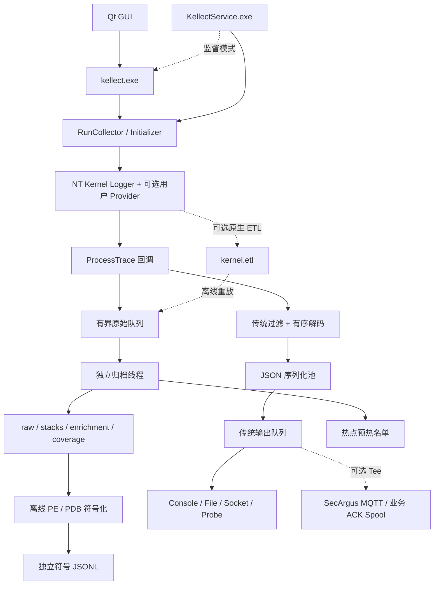

# KellectAgent-Windows 项目报告与技术交接

报告日期为 2026-11-08。本文描述当前工作区的实现。Git 基线为 `d69fcacc1d43ee0b488b9d9a59c89cac9ccd3bd6`，工作区还包含该提交之后的未提交改动及新增文件。阅读项目时，应以当前源码、配置和测试为准。本文所有项目路径均相对于仓库根目录。

## 1. 项目做什么

KellectAgent-Windows 是基于 Event Tracing for Windows（ETW）的 Windows 主机事件采集器。它接收内核及选定用户态 Provider 的事件，面向本地排查、事件分析、留证和后端接入。采集器使用 C++，Windows 服务和 CLI 共享同一采集核心，GUI 通过启动 CLI 子进程显示事件。

当前提供两条用途不同的输出路径。

- **传统事件路径**面向已有消费者。它把已知事件解码成 Kellect JSON，应用过滤与对象名称补全，可输出到控制台、文件、Socket、Kellect Probe，或附加发送到 SecArgus MQTT。
- **VNext 原始证据路径**面向回溯与验证。它在传统过滤之前拷贝 ETW 事件，保留未知事件、原始 Payload、扩展数据、栈帧和采集时钟，并把栈关联、模块定位、符号化与采集状态作为单独结果保存。必要时同时写原生 ETL。

项目当前使用 ETW 和本地符号文件，不包含内核驱动、后端实现或攻击检测模型。Provider 注册、Profile 请求、ETW 实际交付、成功解码和成功留存是不同层级，报告与代码分别记录这些状态。

## 2. 产品、入口与构建关系

| 组件 | 入口或构建目标 | 用途 |
| --- | --- | --- |
| 核心静态库 | 根目录 `CMakeLists.txt` 的 `kellect_core` | ETW 控制、解码、证据归档、输出和协议代码 |
| `kellect.exe` | `source/main.cpp` | 准备控制台，转入 `kellect::RunCollector(args)` |
| `KellectService.exe` | `service/main.cpp` | 作为 Windows 服务运行，也提供安装、卸载和状态查询 |
| `KellectConsole.exe` | `gui/QtKellectConsole/src/main.cpp`，独立 CMake 工程 | Qt 图形控制台，启动采集器、展示事件、转发输出，并管理服务 |
| `evidence_test.exe` | `tools/evidence_test.cpp`，CTest 的 `evidence_archive` | 无需管理员的采集数据结构、归档和符号化回归测试 |
| MSI | `installer/build-msi.bat`、`installer/kellect.wxs` | 将 CLI、服务、配置、GUI 及其运行时打包 |

`source/runtime/collector.cpp` 是 CLI 和服务共用的主调度入口。先判断是否是 `--replay-etl` 或 `--symbolize` 离线命令。实时模式由 `Initializer` 解析配置、检查提权、初始化输出，再根据参数启动归档和 ETW。正常停止时先停止并回收 ETW 消费，再排空解码、序列化与输出线程，最后结算原始证据和 Schema 报告。

`service/service_host.cpp` 负责 SCM 生命周期。`config/agent.ini` 的 `supervisor=0` 默认在服务进程中调用采集核心。`supervisor=1` 时，`service/supervisor.cpp` 管理同目录的 `kellect.exe` 子进程，用命名事件请求优雅停止，使用 Job Object 减少孤儿进程，并在崩溃或配置变化后按逻辑重启。服务安装代码使用 LocalSystem，实际部署权限与启动类型由 SCM 管理。配置在启动时读取，改变需要重启采集实例。

GUI 在 `src/process/KellectProcessService.cpp` 中通过 QProcess 管理子进程，采集端以控制台 JSON 输出。域层负责预设、掩码、UTF-8 行拼接和日志解析。UI 层负责模型、着色、设置与事件详情。文件和 Socket 转发由 GUI 的 `OutputForwarder` 执行。服务面板调用服务产品的管理入口。

## 3. 仓库导航

| 位置 | 职责及关键文件 |
| --- | --- |
| `source/runtime/`、`include/runtime/` | `collector` 调度，`evidence` 原始档案和账本，`symbolize` 离线符号化 |
| `source/initialization/initializer.cpp` | CLI 参数、Profile、过滤文件、传统输出、进程/线程初始快照、预热线程与 UUID |
| `source/process/etw_config.cpp` | 创建与停止本进程持有的 ETW 会话，消费回调、权限错误、ETW 停止统计 |
| `source/process/event_parse.cpp` | 回调的证据分流、传统过滤与队列、序列化及关闭顺序 |
| `source/process/get_properties_kernel.cpp` | 根据传统布局解析已知内核事件，调用栈采用独立解码器 |
| `source/process/get_properties_user.cpp` | 选定用户态 Provider 的 TDH 属性读取 |
| `source/process/event.cpp`、`sub_event.cpp` | `BaseEvent`、事件标识、传统 File/Process/Thread/Image/Registry/Disk/Network 类、上下文补全与传统 JSON |
| `source/process/stack_capture.cpp` | 经典 StackWalk 和扩展栈的字节布局及位宽判断 |
| `source/process/module_history.cpp` | 带时间戳的进程与模块索引，加载/卸载、PID 重用和地址空间判断 |
| `source/process/pe_metadata.cpp` | 将 PE 当作数据读取，提取有界导出表和 CodeView 记录 |
| `source/schema/`、`include/schema/` | 系统版本探测、XML 布局选择、Schema 漂移统计和导出 |
| `source/output/` | 传统 Console/File/Socket、输出队列与多目的地 Tee |
| `source/channel/`、`include/channel/` | WebSocket 客户端、Probe 消息、MessagePack 编码、重连和控制帧 |
| `source/secargus/`、`include/secargus/` | MQTT 3.1.1 客户端、批次、Spool、身份、状态指标和远程命令 |
| `source/tools/`、`include/tools/` | 线程池、统计、日志、字符串与路径处理、第三方库入口 |
| `source/config/` | 配置模板与 Windows 事件布局，构建时复制到产物的 `config/` |
| `service/` | SCM 服务、`agent.ini` 读取、子进程监督 |
| `gui/QtKellectConsole/` | 独立 Qt 应用，包含 UI、进程、域、服务面板与 Qt 测试 |
| `scripts/` | 构建、部署、实采及协议验证 |
| `tools/` | C++ 测试、Schema 分析、协议向量、测试 Broker 和 ACK 响应器 |
| `installer/` | WiX 源、MSI 构建、采集器安装用 manifest |

`bin/` 放常用本地运行产物。`build/collector-x86`、`build/collector-x64` 放 CMake 缓存和测试结果。`dist/` 是独立打包脚本的运行目录。旧 `release/` 中保留历史日志。构建应使用源码配置，部署配置由运行目录提供。详细审计、协议及实验文档在 `docs/`，该目录按仓库现有规则本地忽略。

## 4. 运行时架构



### 4.1 ETW 会话

- 内核采集使用经典 NT Kernel Logger，设置实际 Windows ETW flags。用户态使用另一个会话，通过 `EnableTraceEx2` 启用选中的 Provider。当前 `-u` 为单选，`0x01` 是 Thread Pool，`0x02` 是 DNS Client，`0x03` 是 Print Service。
- `StartTraceW` 返回重名时上报冲突。停止逻辑使用当前进程实际持有的 session handle。成功的 `ControlTraceW(... STOP)` 提供 `EventsLost`、`LogBuffersLost` 和 `RealTimeBuffersLost`。没有成功快照时，证据报告使用 `null`。
- 回调由 `OpenTraceW` 与 `ProcessTrace` 驱动。实时证据使用原始时间戳模式，并把所用时钟写入记录。当前实时内核和证据用户会话请求系统时间。普通用户会话请求 QPC，由 ProcessTrace 交付转换后的时间。
- 内核栈请求使用 `TraceSetInformation(TraceStackTracingInfo)`，只为代码中列出的经典事件类型申请。用户证据会话在请求调用栈时使用 `EVENT_ENABLE_PROPERTY_STACK_TRACE`。最终是否提供栈取决于事件、系统和实际启用结果。
- `--kernel-etl` 让内核 Logger 同时写顺序 ETL。`--replay-etl` 读取 NT Kernel Logger 的 ETL，经相同归档处理链提取新档案，并用背压等待离线队列。

### 4.2 传统解码

1. 内核回调进入后先尝试证据拷贝，之后才进入传统处理。传统分发为已知 Provider 构造 `BaseEvent` 子类，按 PID、丢弃列表等规则过滤，再复制待解析数据。
2. 一个有序线程按配置 XML 读取字段，调用子类的 `parse()`，更新文件对象、注册表、线程到进程、映像等现有映射，再应用后续过滤。此顺序对依赖生命周期映射的处理很重要。
3. JSON 序列化可用 1–8 个线程，默认 1。多个线程完成顺序可交错。已有 WDM 路径依赖共享实体映射，留在有序线程处理。
4. 用户态 Provider 仍走自己的 TDH 属性读取路径。修改这部分时应同时检查 ETW 事件内存生命周期、属性类型和多字段输出行为。
5. `source/schema/schema.cpp` 用 `RtlGetVersion` 获取实际构建号，从 XML 的 `MinBuild` 和 `MaxBuild` 选布局。传统内核布局键仍以 GUID 的 `Data1` 和 Opcode 为主，证据观察目录保留完整 GUID、描述符及头标记。找不到已声明范围时有兼容回退，需要以 `--schema-probe` 验证。
6. Schema 漂移区分完全匹配、存在未声明尾部和已声明字段超出帧长。普通模式尽力输出有效前缀，`--schema-strict` 对短帧等已标记的不完整布局限制输出。原始档案独立保存已进入原始队列的事件。

### 4.3 缓冲、线程与降级语义

| 阶段 | 当前行为 |
| --- | --- |
| ETW Logger | 内核配置申请 1,024 KiB 缓冲块，最小 128、最大 2,048。用户 Logger 申请 5,120 KiB、最小 128、最大 512。以 `session_ledger` 记录的实际值为准 |
| 原始队列 | 约 32 MiB 拷贝预算、16,384 条记录上限，回调不等待写盘。超限或拷贝失败分别计数 |
| 传统解码队列 | 有序解析线程的积压上限为 200,000。证据模式满时计入传统解码丢弃，普通模式用短暂等待施加背压 |
| 序列化队列 | 积压上限为 200,000。队列满由调用者同步序列化，运行完成顺序可变化 |
| 传统输出队列 | 约 500,000 条的背压水位，批量写出，每批最多 15,000 条，空闲轮询约 500 ms |
| 原始 JSONL | 归档线程批量写盘，结束时刷文件。进程或磁盘中断后可能留下不完整尾行，结束标志可能缺失 |
| 网络 | Probe 有内存队列、重连和速率控制。MQTT 有单独队列及磁盘 Spool。传统 Socket 是另一种主输出 |

这些是实现的边界和配置值，不能作为吞吐或零丢失结论。修改性能策略时，要分别测量 ETW 损失、原始队列损失、传统解码丢弃、富化缺失、写入失败和传输积压。

## 5. Profile、配置与命令

### 5.1 Profile

| Profile | Kellect 掩码 | 额外经典内核 flags | 默认栈 | 定位 |
| --- | --- | --- | --- | --- |
| `lightweight` | `0x27` | `0` | 关 | Process、Thread、Image、Registry 基础观测 |
| `provenance` | `0xaf` | `0` | 开 | 增加 File 和 TCP/IP，File 路径还请求所需 Disk 相关 flags |
| `full_kernel` | `0xbf` | `0x90e890` | 开 | 请求更宽的经典内核事件，包括调度、系统调用、内存、ALPC 和驱动相关标志 |
| `full_research` | `0xbf` | `0x90f890` | 开 | 相对 Full Kernel 额外请求全部页错误 flag |

掩码由 `source/config/profiles.ini` 定义。传统 `-e` 掩码与 Windows ETW flags 是两套表示，转换在 `Initializer::initEnabledEvent`。显式 `--profile` 与 `-e` 互斥。单独指定 `--evidence-dir` 且未选择 `-e` 或 `-u` 时使用 `full_kernel`。Profile 默认启用证据归档。传统无 Profile 的默认配置仍走原有选择逻辑。

| 配置文件 | 实际作用 |
| --- | --- |
| `profiles.ini` | Kellect 掩码、附加内核 flags、默认栈开关 |
| `eventStruct_win7.xml`、`eventStruct_win10.xml`、`eventStruct_win11.xml` | 已知内核事件字段定义和 Windows 构建号范围 |
| `filter.txt` | 传统输出的 PID、事件名称和镜像过滤，另有内置 PID/自采集规则 |
| `initImages.txt` | 传统栈 PE 导出预热名单，一行一个 UTF-8 路径 |
| `agent.ini` | SCM 服务名称、启动方式、监督模式及采集参数 |
| `probe.ini` | Probe URL、ID、Token、队列、批次及速率 |
| `secargus.ini` | MQTT、身份、主题、批次、重试、磁盘容量、状态与指标 |
| `log.conf` | 日志初始化 |
| `config/uuid`、`config/endpoint.json`、`config/remote/desired.json` | 运行时生成的主机身份、SecArgus 身份和远程期望配置 |

配置采用相对于进程工作目录的路径。CLI 从包含 `config/` 的产物目录启动最直接。服务启动时把工作目录设置为安装目录。修改源码配置与修改已部署配置有不同作用域。

### 5.2 常用命令

以下命令中的实时采集从已提权控制台执行。离线命令只需文件访问权限。

```powershell
Set-Location .\bin

# 传统采集和日志轮转
.\kellect.exe -e all -f D:\Kellect\events.jsonl --append --max-file-mb 1024

# 原始档案和栈关联
.\kellect.exe --profile provenance --evidence-dir D:\KellectEvidence

# 同时保留原生 ETL 和传统 JSON
.\kellect.exe --profile full_kernel --evidence-dir D:\KellectEvidence --kernel-etl -f D:\Kellect\events.jsonl

# 原生 ETL 重放
.\kellect.exe --replay-etl D:\KellectEvidence\RUN_ID\kernel.etl --evidence-dir D:\KellectReplay

# 离线 PE / PDB 符号化
.\kellect.exe --symbolize D:\KellectEvidence\RUN_ID --image-dir D:\MatchingImages --pdb-dir D:\MatchingPdbs --symbols-out D:\KellectEvidence\RUN_ID\symbols.jsonl

# 用审核后的推荐名单给传统栈解析预热
.\kellect.exe --profile provenance -f D:\Kellect\events.jsonl --prewarm-mode hybrid --init-images D:\KellectEvidence\RUN_ID\initImages.recommended.txt

# 传统输出同时接入 SecArgus
.\kellect.exe -e all -f D:\Kellect\events.jsonl --mqtt
```

其他常用参数包括 `-c`、`-s ip:port`、`--probe`、`--callstack`、`-x`、`--schema-probe <file>` 和 `--serialize-threads <1..8>`。Console、File、Socket、Probe 通常是互斥的主输出。`--mqtt` 可以作为附加输出，也可独立使用。`--stop-event` 是服务监督及测试使用的优雅停机入口。命令支持范围以 `kellect.exe -h` 和 `Initializer::init` 为准。

## 6. 证据档案格式与回溯方式

证据运行在目标目录下创建新的 UUID 子目录。`coverage.jsonl` 的第一条 `capture_start` 记录保存 `run_id`、`host_uuid`、Profile、OS 构建号、请求配置和队列预算。JSONL 每行独立。原始 ID 使用 `run_id / source / raw_seq`，其中序号在各源内独立递增。不要跨归档直接把两个相同序号当成同一事件。

| 文件 | 主要记录和用途 |
| --- | --- |
| `raw.jsonl` | `raw_event`，包含 Provider GUID、ID、版本、Opcode、Task、Keyword、PID、TID、头标记、Activity ID、时钟、原始时间戳、处理器、Logger ID、位宽、`payload_hex` 和扩展数据。传统过滤与解码结果不影响已进入原始队列的字节 |
| `stacks.jsonl` | `stack_artifact` 保存位宽、原始 IP、捕获方法、原始事件时间戳、PID/TID、扩展项索引。经典栈另外写 `stack_association`，关联有界窗口内目标事件 |
| `enrichment.jsonl` | `lifecycle_observation` 保存已解码的进程启停和映像变化，`stack_resolution` 保存帧到模块原始序号、RVA、可用的进程启动序号和降级理由，`hot_image` 保存推荐排序 |
| `coverage.jsonl` | `capture_start`、系统注册 Provider、发现调用状态、`session_ledger`、`observed_event`、`module_resolution_ledger`、`capture_end` |
| `kernel.etl` | 可选原生内核 ETL。离线重放输出新的 run ID 和序号，保留原 ETW 时间戳及内容 |
| `initImages.recommended.txt` | 可转换为盘符路径的前 32 项热点候选。来自成功定位的帧计数，需要审核再作为预热输入 |
| 用户指定的符号 JSONL | `symbolization_start`、`stack_symbols`、`symbolization_end`。输入与输出分离，已有文件受覆盖保护 |

传统 JSON 典型字段为 `Event`、`PID`、`PName`、`PPID`、`PPName`、`TID`、`TimeStamp`、`Host-UUID` 和 `args`。证据模式下传统事件在原始拷贝入队成功时附带 `raw_ref`。它指向尝试归档的原始记录，后续仍应核对文件和结束账本。

### 6.1 回溯步骤

1. 取得传统事件的 `raw_ref`，在同 run 下按 `source/raw_seq` 查 `raw.jsonl`。
2. 查 `stacks.jsonl` 中承载同一原始事件的扩展栈，或查 `stack_association.event_raw_seq` 对应的经典栈。
3. 以 `source / stack_raw_seq / extended_index / index` 联结帧富化结果和可选离线符号。
4. 以 `image_raw_seq` 查同 run 的 `lifecycle_observation` 和原始映像记录。使用 `process_start_raw_seq` 区分可确认的进程实例。
5. 查看 `session_ledger`、`module_resolution_ledger` 和 `capture_end` 判断数据质量。存在丢失、预算耗尽、缺少结束记录或候选歧义时，在消费侧保留该状态。

## 7. 调用栈和符号化设计

**R0 原始栈。** `stack_capture.cpp` 对经典 StackWalk 读取原始目标时间戳、PID、TID 和按位宽编码的地址。扩展栈项有 Match ID 和 32/64 位地址。位宽优先使用头标记，必要时参考日志的位宽。无效或不完整布局仍有原始 ETW 字节供后续分析。

**关联。** 扩展栈直接挂到承载事件。经典栈只用相同原始时间戳、PID 和 TID 做候选匹配，并在前后各 4,096 条内核记录的接收序号范围结算。`unique_in_window` 表示窗口内唯一，另外输出 `ambiguous` 和 `unmatched`。未知时钟或无效身份单独标记。接收序号和 ETW 时间戳都需要保留，单独一个字段无法代表因果关系。

**R1 模块。** 经典 Image v2/v3 与 Process v2–v4 的已识别布局提供映像生命周期、基址、大小、PE 时间戳、校验值和进程身份前缀。历史索引用原始时间处理加载、卸载、进程退出和 PID 重用，单独查询系统地址空间。等时边界、版本未知、地址范围重叠和预算耗尽时保留地址及原因。最多保存 65,536 条历史变更。最多等待约 4,096 条内核记录供乱序数据到达，停机结算有标记。独立用户会话的扩展栈当前只有 R0。

**传统预热。** `off` 关闭传统导出加载，`static` 读取名单，`adaptive` 由栈帧命中模块后触发按需导出读取，`hybrid` 结合两者。证据模式中配合传统输出时，静态候选也交给后台加载。仅归档时可照常获得原始栈、模块定位和热点名单。推荐文件由本次成功定位的帧生成，使用 `--init-images` 可在后续采集中选择指定名单。

**R2/R3 离线符号。** `ReadPeMetadata` 以数据方式映射 PE，检查头、节、RVA 和字符串边界，跳过转发导出和非执行节导出。离线命令在显式给出的本地目录按映像 basename 查找文件，核对 ETW 映像大小和可用的 PE 时间戳及校验值。传入 PDB 目录后，用 PE CodeView 的 GUID/Age 验证 PDB，串行调用 DbgHelp，使用合成基址查询 RVA。缺少匹配 PDB 时可保留精确 PE 导出地址的符号。会话内按 PE 身份及 RVA 缓存结果，汇总缓存命中、解析覆盖和耗时。

离线符号化运行在独立命令中。当前实现没有实时 PDB 解析或符号服务器下载。对于同名多版本映像，可以选择不同的本地映像目录分别运行，并以新输出文件保存各轮结果。PE 匹配依据是 ETW 提供的元数据，PDB 匹配另有 Debug ID 约束。

## 8. 对外输出与后端边界

### 8.1 Kellect Probe

Probe 代码在 `source/channel/`。用户配置 Probe ID 和 Token，客户端通过 `ws://` 建连后发送 JSON `hello`，接收 `hello_ack`、会话 ID 和批次限制。事件批次采用 MessagePack，顶层包括 `v`、`probe_id`、`session_id`、`seq`、`type`、`sent_at`、`events`。每条事件有 `event_id`、`ts`、`category`、`type` 和 `payload`。后台线程处理心跳、速率限制、控制帧与重连。该通道有内存队列，发生过载可丢弃最旧数据。

Probe 的后端契约原由另一个 System 项目的协议文档定义。本仓库提供客户端与 `tools/probe_wire_test.py`。对接时核对后端接受的事件类别、认证字段和帧大小。

### 8.2 SecArgus MQTT

MQTT 使用仓库内的 MQTT 3.1.1/TCP 客户端及 QoS 1。默认主题前缀为 `secargus/v1/endpoints/<endpoint_id>`，下面包括 `events`、`acks`、`status`、`metrics`、`commands`、`replies`。身份配置有 endpoint ID、主机 UUID 和版本。事件批次保留传统事件字段，并包含批次 ID、递增序号、事件计数、时间基准和 payload SHA-256。

批次持久化为独立 `.batch` 文件，重启可读取未确认批次。MQTT PUBACK 只确认传输，应用层收到 `persisted` 或 `duplicate` 才删除相应批次。超过重试次数、队列或磁盘容量时查看状态指标与错误日志。MQTT 的 Spool 用于传输批次，VNext 原始档案使用另一套写盘和损失账本。

远程命令主要用于查询状态、指标、能力和采集配置，并提交期望配置。`update_collection_config` 写入期望配置并报告重启要求。监督模式可检测配置变化并重启采集子进程。具体支持的 `command_id` 幂等和状态见 `source/secargus/commands.cpp`。远程状态与启动/停止命令的回复含义需要按实现理解，命令接收不等同于 SCM 已完成操作。

两个协议均使用当前实现提供的明文连接。真实 Token、Broker 凭据、原始事件、Spool、ETL 和包含路径或命令行的样本应视为运行数据。对外共享测试材料时优先使用脱敏或合成样本。

## 9. 如何构建和验证

### 9.1 构建

根项目要求 CMake 3.22 及以上，核心使用 C++14。Windows 版测试使用 MSVC 的 Release 与静态 CRT。默认脚本通过 vswhere 查找 VS，再进入 x86 工具链并使用 Ninja。GUI 是独立 CMake 工程，使用 C++17、Qt 5 的 Widgets、Network、Test，按官方动态 Qt 的 CRT 策略构建。

```powershell
# 常用 x86 CLI + 服务，产物默认在 bin
cmd /c scripts\build-collector.bat
ctest --test-dir build\collector-x86 --output-on-failure

# 已进入 x64 MSVC 开发者环境时
cmake -S . -B build/collector-x64 -G Ninja -DCMAKE_BUILD_TYPE=Release "-DCMAKE_RUNTIME_OUTPUT_DIRECTORY=$PWD/build/collector-x64/run"
cmake --build build/collector-x64
ctest --test-dir build/collector-x64 --output-on-failure
```

`scripts/build-single.ps1` 可构建独立的 `dist/` 运行目录。`scripts/build-all.bat` 按采集器、GUI、MSI 的顺序构建。GUI 脚本和 MSI 使用 Qt 运行时，MSI 另需 WiX CLI 和 UI 扩展。WiX 的采集器 manifest 在 `installer/kellect.exe.manifest`。当前 CLI 与服务链接的系统库包括 DbgHelp、Winsock、TDH、OLE 和 Advapi32。

### 9.2 当前验证边界

| 验证项 | 当前记录 |
| --- | --- |
| x86、x64 CLI 与服务 | 在 Windows 11 x64 10.0.26200.9457、MSVC 19.51.36260、SDK 10.0.28000.0 上重新构建，两种架构均通过 CTest |
| 原始归档 | CTest 的 `evidence_archive` 使用构造的 EVENT_RECORD 覆盖拷贝、32/64 位栈、关联歧义、降级计数及顺序 |
| 模块定位与符号 | 同一测试覆盖 PID 和基址重用、卸载、晚到映像、热度排序、有界索引、真实 PE/PDB、身份不匹配、精确导出及覆盖保护 |
| CLI | 已验证离线符号化运行、错误路径、非管理员实时采集被拦截 |
| ETW 实采和原生 ETL | 当前会话未提权。实时 Provider 覆盖、ETL 重放的实际数据、吞吐和零观测丢失需要管理员主机复验 |
| Qt GUI 和 MSI | 有独立 Qt 测试与打包定义。当前环境缺少 Qt 开发包，尚未完成本轮 GUI/MSI 构建 |
| Windows 10 与 Windows Server | 有相应适配机制，尚无本轮实机验收结果 |

### 9.3 复验脚本

```powershell
# 管理员 PowerShell，生成带编号 FileIO 负载并检查原始归档与账本
.\scripts\verify-evidence.ps1 -Collector .\bin\kellect.exe -Profile provenance -Count 200
.\scripts\verify-evidence.ps1 -Collector .\bin\kellect.exe -Profile full_kernel -Count 1000 -KernelEtl

# 可选协议实验，需相应 Python 和本地测试环境
python tools\probe_wire_test.py --vectors
.\scripts\verify-secargus.ps1 -Python C:\Path\To\python.exe
```

实采脚本检查 FileIo/Create 载荷中带运行前缀的每个编号，并生成 `verify-result.json`。记录环境、Profile、负载、持续时间、事件数量和各层损失计数。需区分模拟记录通过、单主机实采通过和跨版本兼容性。当前没有足够数据声称所有 Windows 内核事件均覆盖或高负载零丢失。

## 10. 已完成、部分完成与后续工作

| 范围 | 当前状态 | 后续实现或验收 |
| --- | --- | --- |
| ETW 与 Profile | 有经典内核 Logger、单选用户 Provider、Profile、真实启停状态及注册/观察目录 | 系统 Provider 的动态启用矩阵、独立审计来源、各 OS/版本/Opcode 实测覆盖 |
| 数据保真 | 已有原始 Payload、扩展数据、源序号和原始时钟，支持可选 ETL | ETL 实采样本及断电、磁盘满、重启恢复的实验，通用可恢复 Spool |
| 栈捕获与关联 | R0、经典有界关联、扩展直接引用 | 实机验证支持栈的每类事件，处理更长乱序和更完整的关联键 |
| 模块与符号 | R1 模块生命周期、热点名单、传统 PE 预热、离线 R2/R3 | 长运行历史回收策略、自动刷新热点、实时符号后台化和性能对照 |
| 对象关联 | 传统 PID/TID、FileObject、Registry 等映射，证据层覆盖进程及映像的部分生命周期 | 线程、文件、注册表、网络的实例化生命周期及稳定对象身份 |
| 行为证据 | 原始、传统事件、栈、模块之间有引用基础 | 统一 NormalizedEvent / BehaviorEvidence 的 schema、质量模型、对象及事件关系 |
| 后端接入 | 已有 Probe 和 SecArgus MQTT，Kafka 已移除 | 跨层交付账本、端到端部署与故障注入验证 |
| 性能 | 有队列、损失、富化和符号化计数 | A–F、I0–I5 对照，实测 CPU、内存、延迟、吞吐、缓存命中和丢失 |

建议接手时先固定一个管理员测试环境，保留一份真实 ETL 和对应的四类 JSONL。这样可以分别验证 Provider 覆盖、Schema、栈定位和输出变更。再从一个对象族建立可验证的生命周期与证据关系。已有的 `raw_ref`、映像引用、栈引用及损失账本是这项工作的基础。

## 11. 给接手模型的定位清单

| 问题 | 从这里读起 |
| --- | --- |
| 为什么启动或停止失败 | `source/runtime/collector.cpp` → `source/process/etw_config.cpp` → `session_ledger` |
| 为什么某事件不在传统输出 | `source/initialization/initializer.cpp` → `filter.txt` → `event_parse.cpp` → 对应 XML → `sub_event.cpp` |
| 为什么原始记录也找不到 | `coverage.jsonl` 的会话状态、丢失计数、序号缺口、队列、写盘、结束标志 |
| 如何加 Provider 或 Opcode | `profiles.ini`、`initEnabledEvent`、`etw_config.cpp`、`providerInfo.h`、对应 XML、实机 ETW Schema |
| 如何扩展进程/文件生命周期 | `module_history.cpp`、`evidence.cpp`、`sub_event.cpp`，同时核对原始字段和时间范围 |
| 为什么栈有地址却没有函数名 | 栈布局与关联 → `enrichment.jsonl` 模块结果 → PE 身份 → CodeView/PDB 匹配 → 符号输出状态 |
| 如何修改 Probe 或 MQTT | `source/channel/` 与 `source/secargus/` 各自独立。先辨认传输与后端协议，再检查队列、重连与确认语义 |
| 如何改交付或运行目录 | 根 `CMakeLists.txt`、`scripts/build-collector.bat`、`scripts/build-single.ps1`、`installer/build-msi.bat` |

补充材料可参阅 [源码审计](docs/audit-existing-kellect.md)、[验证与覆盖记录](docs/baseline.md)、[双产品架构](docs/ARCHITECTURE.zh-CN.md)、[探针协议](docs/PROBE-CHANNEL.zh-CN.md)、[SecArgus 构建测试](docs/SECARGUS-BUILD-TEST.zh-CN.md) 和 [性能说明](docs/PERFORMANCE.zh-CN.md)。

## 12. 本轮目录整理

- 删除无调用入口的旧内核 TDH 实验分支、旧线程包装器、停用的 DIA 声明与头文件、重复的 nlohmann JSON 3.10.4 单头文件。当前 JSON 依赖位于 `include/nlohmann/`。
- 从旧 `release/config` 移除未被构建或运行入口引用的重复配置，MSI 所需 manifest 归入 `installer/`。历史日志保留在 `release/`。
- 清理 442 个过期构建与合成测试文件，约 342 MiB。新编译缓存统一位于 `build/collector-x86` 和 `build/collector-x64`，CTest 可执行文件与产物位于对应构建目录。已部署配置、历史日志、Spool 和现有运行目录按其原用途保留。
